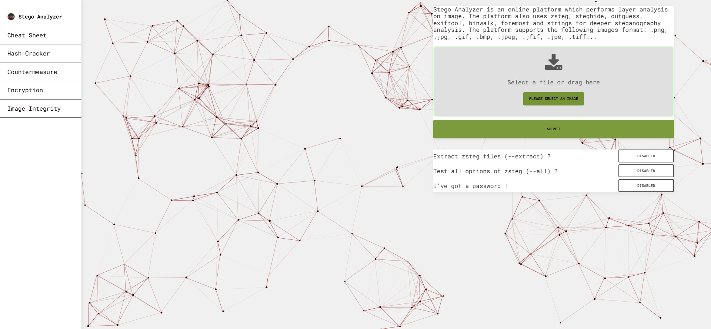
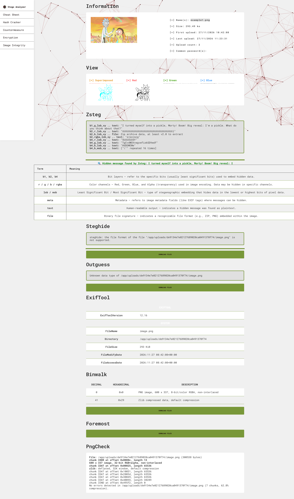
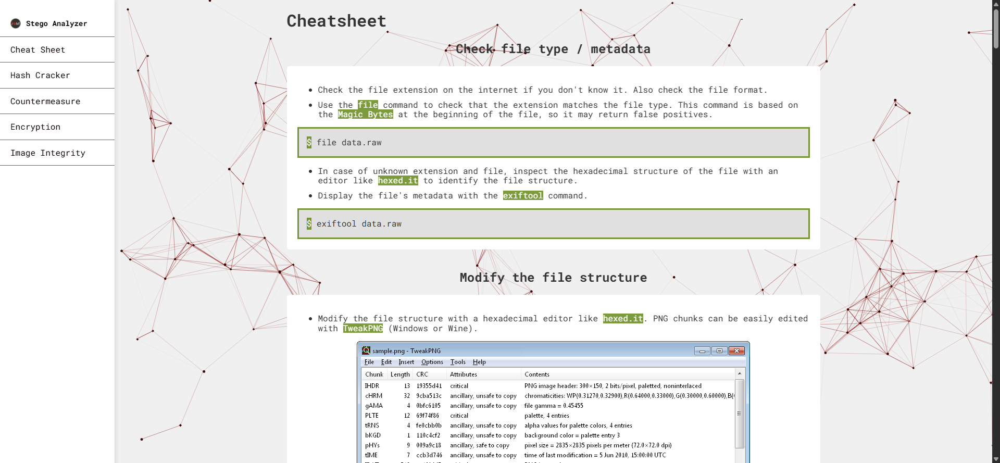
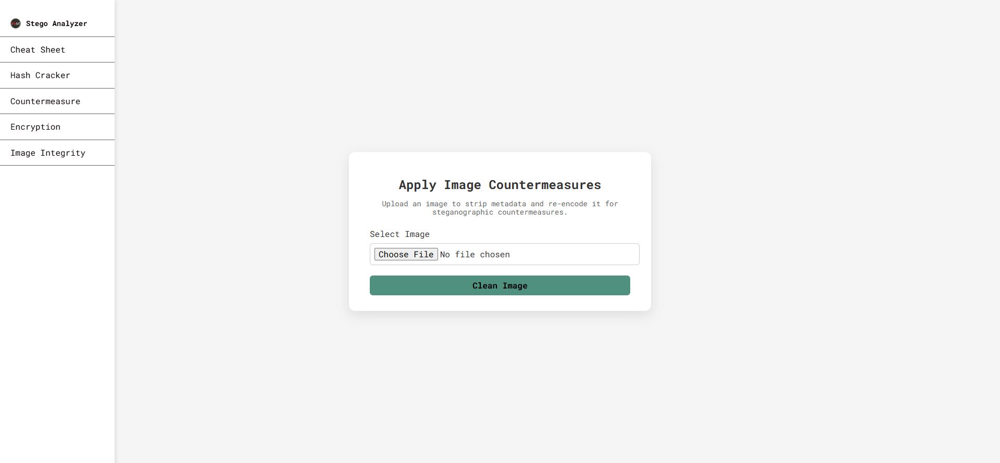
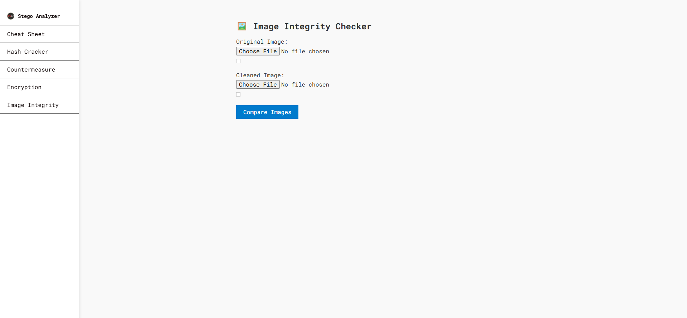
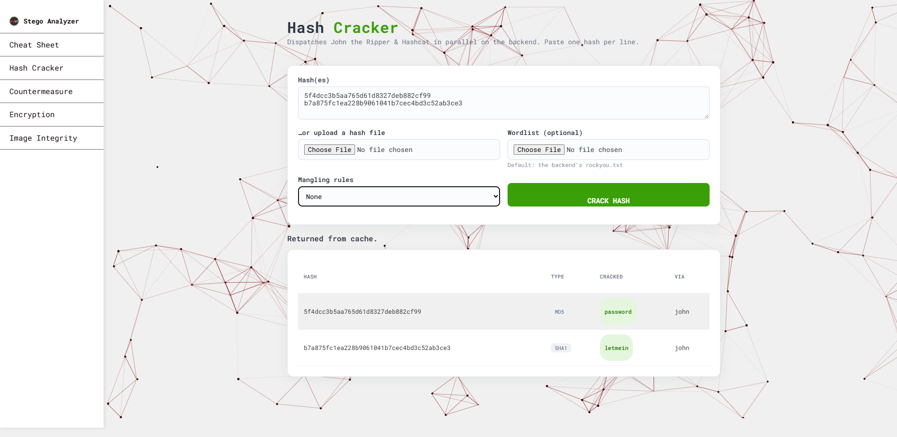
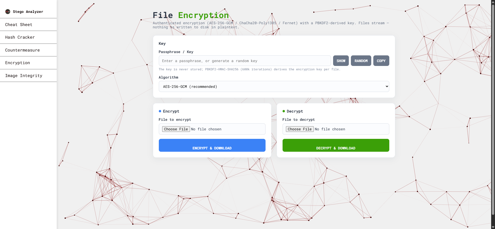
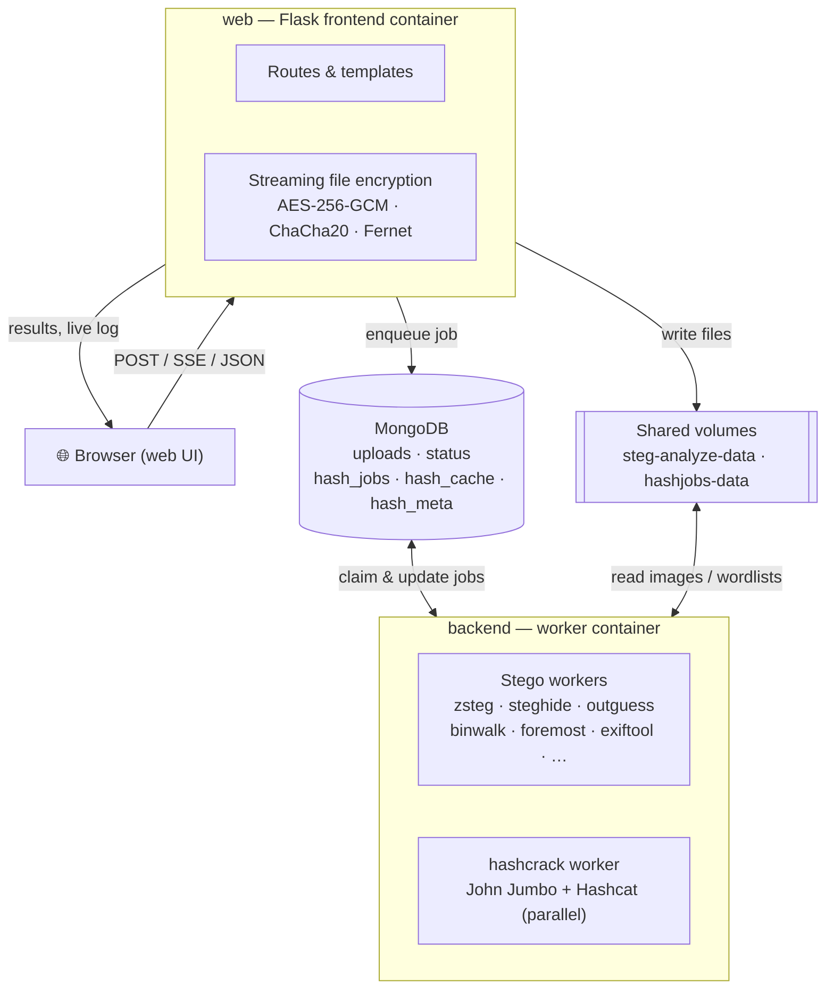

# Stego Analyzer

**A self-hosted steganography analysis platform and offensive-security toolkit.**
Upload a suspicious image and a fleet of background workers runs the standard
steganography toolchain against it; alongside the analysis engine, Stego Analyzer
ships two hardened security utilities — an asynchronous **Hash Cracker** and an
authenticated **File Encryption** tool — all behind one web UI, orchestrated with
Docker Compose.

---

## Table of Contents

1. [What it does](#what-it-does)
2. [Features](#features)
   - [Steganography analysis](#-steganography-analysis)
   - [Hash Cracker](#-hash-cracker)
   - [File Encryption](#-file-encryption)
   - [Image utilities](#-image-utilities)
3. [Screenshots](#screenshots)
4. [Architecture](#architecture)
5. [Tech stack](#tech-stack)
6. [Quick start (Docker Compose)](#quick-start-docker-compose)
7. [Configuration](#configuration)
8. [Using the tools](#using-the-tools)
9. [Development](#development)
10. [Troubleshooting](#troubleshooting)
11. [Security notes](#security-notes)
12. [License](#license)

---

## What it does

Stego Analyzer is built for CTF players, security researchers, and anyone who needs
to pull hidden data out of images or work with hashes and encrypted files. It is a
two-tier application:

- a **Flask web frontend** that accepts uploads, renders results, and exposes a small
  JSON/SSE API, and
- a **worker backend** (a separate container packed with the heavy CLI tools) that
  picks up jobs, runs them, and writes results back.

The two tiers never call each other directly — they coordinate through **MongoDB**
(job state) and **shared Docker volumes** (file hand-off). This is the same dispatch
pattern used throughout the app, so every long-running task stays off the request
thread and the UI never blocks.

---

## Features

### 🔎 Steganography analysis

Drop in a PNG/JPG/BMP/GIF/TIFF and the backend fans the image out to a battery of
tools, each running as an independent, self-healing worker:

| Tool | Purpose |
|------|---------|
| `zsteg` | LSB / channel steganography in PNG/BMP |
| `steghide`, `outguess` | Password-based payload extraction |
| `binwalk`, `foremost` | Embedded file carving |
| `exiftool` | Metadata inspection |
| `strings` | Printable-string extraction |
| `pngcheck`, `pcrt` | PNG integrity / corruption repair |
| `stegexpose` | Statistical LSB detection |

Results, per-tool status, and aggregate **statistics** (`/stats`, `/top`) are stored
in MongoDB and surfaced in the UI. A built-in **cheat sheet** documents the manual
commands behind each tool.

### 🔑 Hash Cracker

An asynchronous cracking pipeline that dispatches jobs to the backend (where John the
Ripper and Hashcat live) and streams progress back to the browser.

- **Parallel engines** — John the Ripper (Jumbo) and Hashcat run concurrently per
  hash-type group via a thread pool.
- **Heuristic hash detection** (no brittle subprocess) — recognises MD5, SHA-1/224/256/384/512,
  NTLM/LM, bcrypt, `sha512crypt`/`sha256crypt`/`md5crypt`, MySQL323 / MySQL4+, and
  WPA-PMKID, falling back to `hashid` only if needed.
- **Multi-hash jobs** — paste or upload many hashes; results are reported one per line.
- **Result caching** — every cracked hash is cached in MongoDB keyed by
  `sha256(hash)`, so resubmitting a known hash returns in well under 100 ms.
- **Live progress** over **Server-Sent Events** — tool output streams into the UI as
  it happens.
- **Mangling rules** — pick `best64` / `toggles` / `dive` for a stronger attack.
- **Rate limiting** — the endpoint is capped at **5 requests/minute per IP** (HTTP 429).
- **Wordlist handling** — ships with rockyou by default, validates its presence at
  startup, and accepts a custom wordlist upload.

### 🔐 File Encryption

Modern authenticated encryption with a self-describing container format — a full
rewrite of the original weak `MD5(key)→Fernet` scheme.

- **Strong key derivation** — PBKDF2-HMAC-SHA256, 600,000 iterations, with a random
  16-byte salt stored per file.
- **Authenticated algorithms** — AES-256-GCM (recommended), ChaCha20-Poly1305
  (mobile-friendly), or Fernet (easy). Each chunk is bound to its position with AAD,
  defeating chunk-swap / reorder / truncation attacks.
- **Streaming** — files are processed in chunks and streamed to the browser, so even
  large files never sit in memory as plaintext and **no plaintext temp file is ever
  written to disk** (a 100 MB cap is enforced).
- **Self-describing header** (`STG1`) — algorithm, version, salt, and nonce travel
  with the ciphertext, so a file can be decrypted with the key alone.
- **Backward compatible** — files produced by the legacy Fernet-chunk format still
  decrypt transparently.
- **UX niceties** — password-masked key field, one-click strong **random key**,
  modern `navigator.clipboard` copy (with fallback), and a client-side **SHA-256
  checksum** of the decrypted file for integrity verification.

### 🧰 Image utilities

- **Countermeasures** — strip metadata and scrub LSBs to neutralise hidden payloads.
- **Image Integrity** — pixel-diff two images and report a similarity score.
- **Metadata hide** — embed a Base64 payload into EXIF fields.

---

## Screenshots

### Steganography analysis

**Upload** — drop an image in and choose zsteg options:



**Analysis result** — bit-plane views plus combined output from zsteg (hidden text
and an embedded ZIP are flagged), steghide, outguess, exiftool, binwalk, foremost
and pngcheck on a single page:



**Cheat sheet** — reference commands behind each tool:



**Countermeasure** — strip metadata / scrub LSBs:



**Image integrity** — pixel-diff two images for a similarity score:



### Hash Cracker

Multi-hash input, live output, and a results table with detected type and recovered
plaintext:



### File Encryption

Passphrase + algorithm selector with streaming encrypt/decrypt:



---

## Architecture



**Services** (`docker-compose.yml`): `web`, `backend`, `mongodb`.

**MongoDB collections**

| Collection | Written by | Purpose |
|------------|-----------|---------|
| `uploads`, `status` | web + stego workers | Image analysis jobs and per-tool status |
| `hash_jobs` | web (enqueue) + hashcrack worker | Cracking job state, results, live log |
| `hash_cache` | hashcrack worker | Cracked hashes keyed by `sha256(hash)` |
| `hash_meta` | hashcrack worker | Health (wordlist availability) |

**Shared volumes**: `steg-analyze-data` (images) and `hashjobs-data` (custom
wordlist hand-off), each mounted into both `web` and `backend`.

---

## Tech stack

- **Backend web**: Python 3.10, Flask, Flask-PyMongo, Flask-Limiter, `cryptography`
- **Worker backend**: Debian, John the Ripper **Jumbo**, Hashcat, zsteg, steghide,
  outguess, binwalk, foremost, exiftool, pngcheck, stegexpose, `hashid`
- **Database**: MongoDB 4.0
- **Orchestration**: Docker Compose

---

## Quick start (Docker Compose)

### Prerequisites

- Docker Desktop (with the WSL 2 backend on Windows) or Docker Engine + Compose v2
- Git

### Run

```bash
git clone https://github.com/Vaisah/stego.git
cd stego

# create your environment file from the template, then edit the values
cp .env.example .env

docker compose up -d --build
```

Then open **<http://localhost:5000>**.

> **First build note:** the worker image compiles John the Ripper Jumbo and
> downloads the rockyou wordlist, so the initial `backend` build takes several
> minutes. Subsequent builds are cached.

Check everything is up:

```bash
docker compose ps
docker compose logs -f backend   # watch the workers start
```

---

## Configuration

Copy `.env.example` to `.env` and set the values. The `web` container connects to
MongoDB with the credentials baked into `docker-compose.yml` + `mongo/mongo-init.js`,
so the **backend** `MONGODB_*` values must match that database:

| Key | Value for the bundled stack |
|-----|------------------------------|
| `MONGODB_HOSTNAME` | `mongodb` (the Compose service name) |
| `MONGODB_DATABASE` | `flaskdb` |
| `MONGODB_USERNAME` | `flaskuser` |
| `MONGODB_PASSWORD` | matches `mongo-init.js` |

Optional worker overrides (sensible defaults in the image): `DEFAULT_WORDLIST`,
`HASHJOBS_DIR`, `JOHN_BIN`, `HASHCAT_BIN`.

---

## Using the tools

Everything is reachable from the left sidebar:

- **Home** — upload an image to run the full steganography analysis.
- **Hash Cracker** (`/crack_hash`) — paste hashes (one per line) or upload a file,
  optionally add a wordlist / rule, and watch results stream in.
- **Encryption** (`/crypto`) — enter or generate a key, pick an algorithm, and
  encrypt or decrypt a file; the decrypted file's SHA-256 is shown for verification.
- **Countermeasure**, **Image Integrity**, **Cheat Sheet** — supporting utilities.

---

## Development

- Code lives in `web/` (Flask app + templates) and `backend/` (worker modules).
- The web app auto-reloads templates (`FLASK_ENV=development`). After changing
  **Python** or **worker** code, rebuild the affected image:

  ```bash
  docker compose build web      # or: backend
  docker compose up -d web
  ```

- Backend workers are plain scripts under `backend/modules/`, supervised by
  `backend/start.sh`. Adding a tool means adding a worker module and a watchdog entry.

---

## Troubleshooting

- **Backend container exits immediately / `exec ./start.sh: no such file or directory`** —
  Windows checked the scripts out with CRLF line endings. The Docker build normalises
  them, so a clean `docker compose build backend` fixes it.
- **`apt` 404s while building the backend** — the Debian bullseye base is end-of-life;
  the Dockerfile repoints apt at `archive.debian.org`. Rebuild with no cache if you
  hit a stale layer: `docker compose build --no-cache backend`.
- **Hash jobs error with "wordlist not found"** — the default rockyou download failed
  during build; upload a wordlist in the UI, or rebuild the backend.
- **Workers can't reach MongoDB** — check the `MONGODB_*` values in `.env` match the
  table in [Configuration](#configuration).

---

## Security notes

This project is intended for **authorized security testing, CTF, and research**. The
cracking tools and wordlists are powerful — only run them against hashes you are
permitted to test. The bundled MongoDB credentials and `.env.example` values are for
local use; change them before exposing the app anywhere.

---

## License

See [LICENSE](LICENSE).
